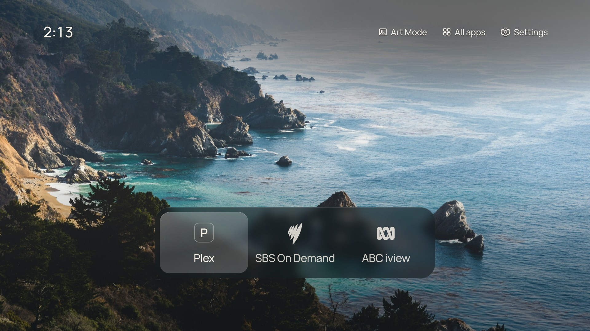

# CleanFrame Hisense

A quiet home screen for Hisense VIDAA TVs: your apps, your photograph and your remote. Based on [CleanFrame by Nathan Clark](https://github.com/nthnclrk/CleanFrame).



Choose a list or dock, launch installed TV apps, and let the controls fade away to show your artwork. Optional Home return brings you back to CleanFrame when you press Home on the Hisense remote.

CleanFrame runs as a TV app with a small service on an always-on home server. It keeps your TV's existing firmware and apps.

## Set it up with your AI agent

**This project assumes you'll use a local coding agent to configure it for your TV and home server.** Setup is guided and still experimental. Your agent needs access to this repository, your home network and a server or NAS running Docker Compose.

Give your agent this repository and paste the prompt below. Fill in what you know; it can help you find the rest.

```text
Help me configure and install CleanFrame Hisense for my TV.
Read AGENTS.md and docs/agent-tv-setup-guide.md first.

TV model and firmware: [fill in, or help me find them]
Home server / NAS: [fill in]
Apps I want on Home: [fill in]

Check the tested-model notes and pairing prerequisites before starting.
Ask for missing details and explain each step in plain language.
Prepare the Docker service, guide me through TV pairing, and install
the CleanFrame Home tile. Keep credentials and personal network
details out of Git and shared logs.

Tell me before launching apps or restarting services. Ask me to
verify the screen, app launches and Home return on the actual TV.
Preserve the TV's firmware and existing settings, and explain how
to turn automatic Home return off.
```

Initial pairing requires a locally supplied TV connection certificate. Your agent should check the [setup prerequisites](docs/agent-tv-setup-guide.md#prerequisites) first; this preparation is not automated yet.

## Tested TVs

| Model | System / firmware | Confirmed working |
| --- | --- | --- |
| Hisense 55S7NAU CanvasTV (Australia) | VIDAA 9 · `V0000.09.60X.Q0609` | Home screen, remote navigation, appearance settings, Home return from Plex, and native Plex, SBS, ABC, IPTV Smarters and Stremio Lite apps |

Other models are untested. Native Art Gallery behaviour, idle/wake, automatic startup and persistence after a TV restart still need physical confirmation. See [full compatibility notes](docs/tv-status.md). Reports from other owners are welcome.

## More information

- [Setup and recovery](docs/agent-tv-setup-guide.md)
- [Browser preview and development](docs/development.md)
- [Testing](docs/testing.md) · [Contributing](CONTRIBUTING.md)

## Credits and licence

Thanks to [CleanFrame](https://github.com/nthnclrk/CleanFrame) for the original interface and [Sidee](https://github.com/Empi9245/Sidee) for the TV connection code. Original copyright and [MIT licence](LICENSE) notices are preserved. Fonts, photographs and service marks retain their [own terms and credits](THIRD_PARTY_NOTICES.md).

This project is independent of Hisense, VIDAA and the streaming services.
